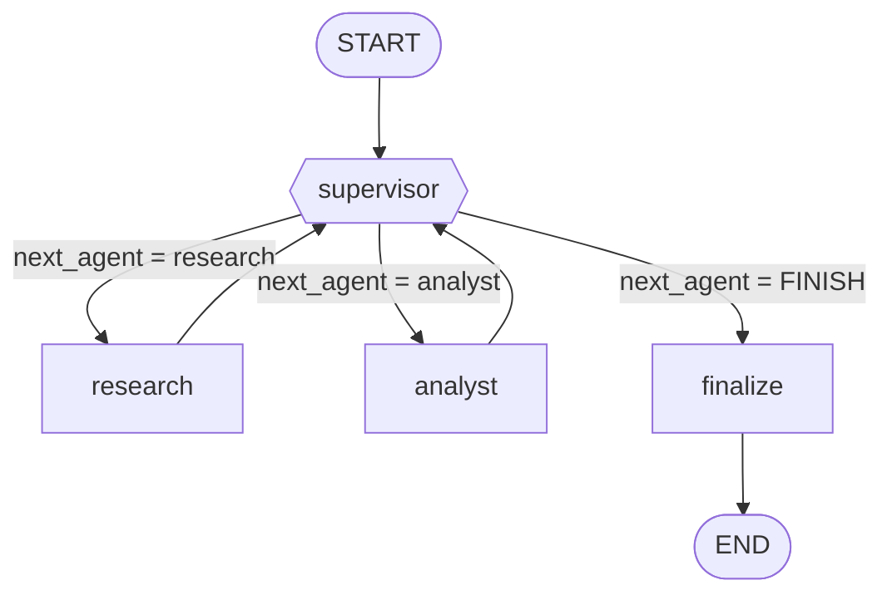
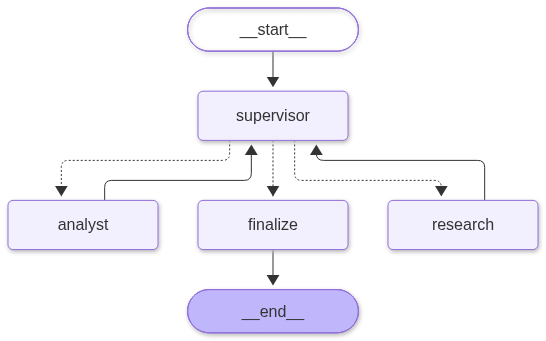

# Orquestador multi-agente · Código Tributario de Uruguay

Pre-entrega 6 · CoderHouse AI Engineering. Un **Supervisor** (LangGraph) coordina a dos agentes
especializados para responder consultas sobre el Código Tributario uruguayo (Decreto-Ley 14.306):

| Agente | Rol | Herramientas |
|---|---|---|
| **Supervisor** | Router y controlador de flujo. Decide quién actúa, valida con una rúbrica y corta el ciclo. | — (decide con salida estructurada) |
| **Investigador** (`research`) | Busca y lee artículos. Es el único que trae evidencia. | `search_articles` (RAG híbrido BM25 + Pinecone), `read_article` |
| **Analista** (`analyst`) | Hace cálculos con cifras que ya están en la evidencia. | `calculate_percentage`, `calculate_expression`, `days_between`, `add_years` |

> **Requiere Python 3.12 o superior.**

Este proyecto reutiliza el índice de Pinecone de la pre-entrega 4 (`llm-rag-pinecone`) y el patrón de
agente ReAct de la pre-entrega 5. No hay IDs ni modelos fijos en el código: todo sale de `.env`.

---

## 1. Topología y por qué



Es una topología **jerárquica con el supervisor en el centro** (hub and spoke): los especialistas
nunca se hablan entre sí ni deciden quién sigue; siempre devuelven el control al Supervisor.

- **Por qué no una cadena fija** (`research → analyst`): hay preguntas que no necesitan cálculo
  (el analista sobra) y otras donde la búsqueda sale pobre y hay que repetirla. El camino lo decide
  el contenido de la consulta, no el código.
- **Por qué no agentes que se pasan la posta entre sí** (network): con dos especialistas no hay
  ganancia, y se pierde un único lugar donde auditar y limitar el flujo.
- **La arista condicional** usa `route()`, anotada con `Literal["research", "analyst", "finalize"]`,
  que traduce `next_agent` al nombre del nodo (`FINISH → finalize`). Está en `src/supervisor.py` y
  se cablea en `src/graph.py` con `add_conditional_edges`.
- El nodo **`finalize`** redacta la respuesta final usando **solo** la evidencia recolectada. Está
  separado del Supervisor para que decidir y redactar sean dos responsabilidades distintas.

Diagrama generado por LangGraph a partir del grafo real con `graph.get_graph().draw_mermaid_png()`
(las líneas punteadas son las aristas condicionales del Supervisor; el texto Mermaid del grafo real se
imprime con `python main.py mermaid`):



### Estado compartido (`src/state.py`)

`OrchestratorState` hereda de `MessagesState` y agrega:

| Campo | Para qué | ¿Cómo se actualiza? |
|---|---|---|
| `question` | Pregunta original | se escribe una vez |
| `next_agent` | Decisión del Supervisor: `research` / `analyst` / `FINISH` | se sobrescribe |
| `instruction`, `reason` | Qué le pide al especialista y por qué (auditable) | se sobrescribe |
| `task_completed` | `True` cuando el Supervisor decide `FINISH` | se sobrescribe |
| `step_count` | Decisiones del Supervisor hasta ahora | **reducer `operator.add`** |
| `contributions` | Qué aportó cada agente (artículos, herramientas, estado, ms) | **reducer** |
| `traces`, `errors` | Traza por nodo y fallas aisladas | **reducer** |
| `final_answer` | Respuesta final | se sobrescribe |

Los campos con reducer **suman** lo que devuelve cada nodo en lugar de pisarlo: ningún agente
borra el trabajo de otro. Todo el estado es serializable a JSON, listo para un checkpointer.

---

## 2. Cómo se evitan los dos problemas clásicos

### "Supervisor Infinito"
Un LLM puede pedir "una búsqueda más" indefinidamente. No confiamos en que no lo haga: las
**guardas deterministas** (`apply_guards`) tienen la última palabra sobre lo que decida el modelo.

1. **Techo de pasos** (`MAX_STEPS`, por defecto 6): al llegar, se fuerza `FINISH`.
2. **Tope por agente** (`MAX_CALLS_PER_AGENT`, por defecto 2): si pide refinar por tercera vez, se finaliza.
3. **Red final**: `recursion_limit` de LangGraph (`RECURSION_LIMIT`). Si igual se alcanzara,
   `run_query` captura `GraphRecursionError` y devuelve un mensaje seguro en vez de romper.

### Contaminación de contexto
Cada especialista recibe **solo** la pregunta original y la instrucción del Supervisor, nunca el
historial completo ni el prompt del Supervisor. El analista recibe además la evidencia ya
recortada (presupuesto de caracteres por bloque, `MAX_EVIDENCE_CHARS`). El Supervisor, a su vez,
no ve el texto crudo de las herramientas sino un resumen compacto de cada contribución.
Hay tests que verifican esto explícitamente (`tests/test_graph.py`).

---

## 3. Manejo de conflictos entre agentes

| Situación | Qué hace el sistema |
|---|---|
| El LLM del Supervisor devuelve algo inválido o falla | Se usa `fallback_decision` (política determinista: investigar → calcular si la pregunta lo pide → finalizar). El error queda en `errors`. |
| El Supervisor quiere **calcular o finalizar sin evidencia** | La guarda lo redirige a `research`. No se calcula ni se responde sin fuente. |
| El Supervisor pide refinar sin parar | Tope de llamadas por agente: se corta y se finaliza. |
| Un especialista **falla** (LLM caído, herramienta rota) | Se aísla: su contribución queda con `status="error"`, el grafo **no se rompe** y el Supervisor puede reintentar o finalizar. |
| La investigación no encuentra artículos pertinentes (o la pregunta es de otro tema) | Cuenta como "sin evidencia": la respuesta final lo dice explícitamente y **no inventa**. |
| Falta un dato para calcular (p. ej. una tasa de recargo que el artículo no fija) | La rúbrica (punto d) exige declararlo en vez de suponerlo. |
| Falla el LLM de síntesis | Respuesta de respaldo determinista que lista los artículos consultados. |
| Una herramienta recibe argumentos inválidos | Validación con Pydantic (`args_schema`); el error vuelve al agente **como dato** y puede corregirlo. |

### Rúbrica de validación
Está en el prompt del Supervisor (`SUPERVISOR_PROMPT`). Para `FINISH` deben cumplirse todas:

1. El investigador citó al menos un artículo pertinente.
2. Toda cifra informada viene de un artículo citado o de un cálculo del analista.
3. Si se pidió un cálculo, el analista lo hizo y mostró la fórmula.
4. Si falta un dato necesario, el resultado lo declara.

---

## 4. Estructura del proyecto

```
main.py                 CLI: simular | preguntar | demo | mermaid
src/
  state.py              OrchestratorState (estado + reducers)
  schemas.py            Modelos Pydantic (decisión del Supervisor, contribuciones, I/O de herramientas)
  supervisor.py         Prompt + rúbrica, guardas, política de respaldo, route()
  finalizer.py          Nodo de síntesis (solo con evidencia)
  graph.py              build_graph(): nodos, aristas y arista condicional
  agents/               react.py (ciclo ReAct + aislamiento de fallas), research_agent.py, analyst_agent.py
  tools/                research_tools.py (RAG), analyst_tools.py (cálculo seguro, sin eval)
  rag/                  RAGSystem (BM25 + Pinecone), lectura de data/chunks.jsonl
  evidence.py           Reglas sobre qué cuenta como evidencia y cómo se recorta
  runner.py             run_query, traza formateada y guardado JSON
  simulation.py         LLM/retriever simulados para correr el grafo real sin API keys
data/chunks.jsonl       Chunks del Código Tributario (BM25 y lectura de artículos)
tests/                  52 tests, sin dependencias pesadas ni API keys
traces/                 Trazas JSON de las ejecuciones
notebooks/demo.ipynb    Demostración del flujo de delegación
```

---

## 5. Cómo correrlo

```bash
python3.12 -m venv .venv && source .venv/bin/activate
pip install -r requirements.txt
```

**Sin API keys** (grafo, Supervisor y herramientas reales; LLM y retriever simulados):

```bash
pytest -q                 # 52 tests
python main.py simular    # flujo completo con traza
```

**Ejecución real** (Gemini + Pinecone, requiere el índice de la pre-entrega 4):

```bash
cp .env.example .env      # completar GOOGLE_API_KEY y PINECONE_API_KEY
python main.py preguntar "Pagué con 100 días de atraso un tributo de $50.000. ¿Qué multa corresponde?"
python main.py demo       # 3 consultas y guarda traces/traza_demo_{1,2,3}.json
```

La primera ejecución real descarga el modelo de embeddings (`multilingual-e5-small`).

---

## 6. Evidencia de ejecución

### Simulación (LLM y retriever simulados, código del grafo real)

Salida de `python main.py simular` (guardada en `traces/traza_simulacion.json`):

```
 #  nodo        paso        ms  detalle
 1  supervisor     0       0.1  → research · Todavía no hay evidencia: hay que investigar primero.
 2  research       1      22.7  ok · herramientas: search_articles, read_article · artículos: 33, 93, 94, 97
 3  supervisor     1       0.1  → analyst · La pregunta pide un monto y ya hay artículo citado.
 4  analyst        2       4.5  ok · herramientas: calculate_percentage
 5  supervisor     2       0.0  → FINISH · Rúbrica cumplida: artículo citado, cálculo con fórmula y dato faltante declarado.
 6  finalize       3       0.8  modo=llm
```

La respuesta de la simulación está marcada con `[SIMULACIÓN]`: sirve para demostrar el flujo de
delegación, no para evaluar la calidad de las respuestas.

### Ejecución real

Salida de `python main.py demo` con Gemini (`gemini-3.5-flash-lite`) y Pinecone. Las trazas completas
están en `traces/traza_demo_1.json`, `traza_demo_2.json` y `traza_demo_3.json`.

**Consulta 1 · camino completo (investigar + calcular).** *«Pagué con 100 días de atraso un tributo de $50.000. ¿Qué multa por mora corresponde y de cuánto sería?»*

```
 #  nodo        paso        ms  detalle
 1  supervisor     0    3374.0  → research · Se necesita evidencia oficial del Código Tributario sobre la multa por mora.
 2  research       1   37479.8  ok · herramientas: search_articles, read_article · artículos: 94, 89, 46, 98
 3  supervisor     1    6440.3  → research · El texto del Artículo 94 quedó truncado: falta el literal aplicable.
 4  research       2   34316.1  ok · herramientas: read_article · artículos: 94
 5  supervisor     2    7673.1  → analyst · Ya está el Art. 94 literal C (20%): corresponde delegar el cálculo.
 6  analyst        3    8422.1  ok · herramientas: calculate_percentage
 7  supervisor     3    3149.5  → FINISH · Rúbrica cumplida: artículo citado, cálculo con fórmula y dato faltante declarado.
 8  finalize       4    1594.6  modo=llm
```

Respuesta: multa del 20% (Art. 94, literal C) = **$10.000**; el recargo mensual no se calcula porque su tasa
la fija el Poder Ejecutivo y no figura en el texto.

**Consulta 2 · solo investigar.** El Supervisor finaliza sin llamar al Analista (2 decisiones: `research` → `FINISH`).
Respuesta: prescripción general a los 5 años, ampliada a 10 en defraudación, falta de inscripción o de
declaración, y cuando el organismo no tuvo conocimiento del hecho (Art. 38).

**Consulta 3 · fuera de tema (control).** *«¿Cuál es la receta tradicional del chivito uruguayo?»* La guarda determinista
obliga a investigar primero (`override=sin evidencia del investigador`); luego el Supervisor finaliza y la respuesta
declara que el Código Tributario no contiene información sobre el tema, sin inventar nada.

Las tres corridas terminaron sin errores. El notebook `notebooks/demo.ipynb` ejecuta el mismo flujo y muestra la tabla de delegación.

---

## 7. Cumplimiento de la consigna

| Requisito | Dónde está |
|---|---|
| `state.py` con estado compartido | `src/state.py` (`next_agent`, `task_completed`, acumuladores con reducer) |
| Agentes especializados (investigador + analista) | `src/agents/research_agent.py`, `src/agents/analyst_agent.py` |
| Tools funcionales por agente | `src/tools/research_tools.py`, `src/tools/analyst_tools.py` (validadas con Pydantic) |
| Nodo Supervisor con aristas condicionales y `Literal` | `src/supervisor.py` (`route`) + `src/graph.py` (`add_conditional_edges`) |
| Rúbrica de validación en el prompt del Supervisor | `SUPERVISOR_PROMPT` en `src/supervisor.py` + guardas deterministas |
| Evitar "Supervisor Infinito" | `MAX_STEPS`, `MAX_CALLS_PER_AGENT`, `recursion_limit` (tests en `tests/test_graph.py`) |
| Evitar contaminación de contexto | Entradas mínimas por especialista (tests de aislamiento) |
| README con Mermaid y explicación de topología y conflictos | Secciones 1 a 3 de este archivo |
| Demostración del flujo de delegación | `python main.py simular` / `demo`, `notebooks/demo.ipynb`, `traces/` |

---

## 8. Pensado para crecer

`build_graph(llm, rag, chunks, checkpointer=None)` acepta un checkpointer y todo el estado es
serializable; los nodos son `async`; la configuración sale de variables de entorno. Eso permite
sumar después una API asíncrona, persistencia de hilos, observabilidad y aprobación humana
sin reescribir el grafo.

*Información orientativa basada en el texto del Código Tributario; no constituye asesoramiento legal.*
